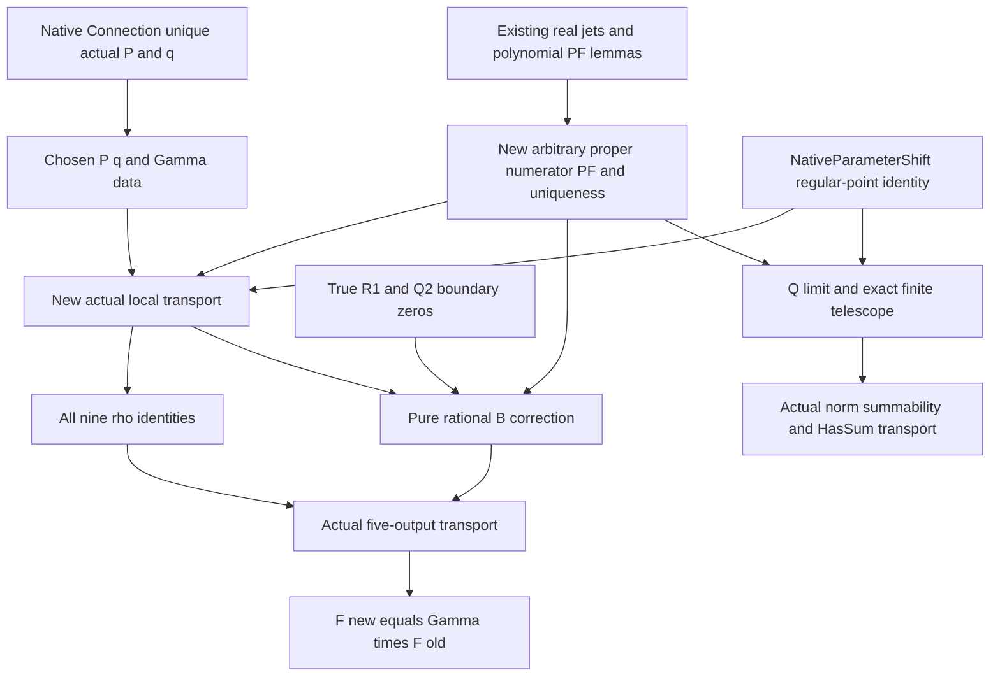

# Actual five-output parameter transport: next proof design

This is a mathematical implementation design and an uncompiled data candidate.
It is not a Lean PASS, platform proof, determinant formula or irrationality
result. The original target is p=9,q=1,m=n,d=0, even n>=2, with the actual
outputs `(B,rho3,rho5,rho7,rho9)` already defined in CoefficientMapAggregate.
NativeParameterShift and Connection prove the pointwise identity and the actual
unique P/q systems; neither yet proves the five-coordinate transport below.

The shortest faithful route closes B entirely in rational finite algebra.
Actual finite/absolute summation supplies a separate consistency theorem;
no inference uses independence of zeta values.

## 1. Actual chosen data and orientation

For r in Fin5, choose the unique pair `(P_r,q_r)` from
`CoefficientMapConnection.connection_five_systems_unique n hn r`, retaining
`n>=1`, `natDegree P_r<=4`, `natDegree q_r<=9`, and the actual equation

`D_n P_r(u_n)+H_n(q_r)=c_n Z_n(u_n)(u_n-n-1)^r`.

Set `Gamma_n(r,l)=coeff_l(P_r)`. Matrix rows are new monomial indices and
columns old monomial indices. The target is **left multiplication**

`actualFMatrix(n+2) = Gamma_n * actualFMatrix(n)`.

This follows from `aggregate(n+2,X^r)=aggregate(n,P_r)` and the existing
quartic polynomial reconstruction/aggregate linearity. No Fin15 connection
matrix is confused with the actual five-output F. Choosing zero at n=0 is
only a data convention; all Connection specifications retain n>=1.

The new candidate is `formalization/CoefficientMapFormalTransportData.lean`.
It contains the actual choice, Gamma, true remainder numerator and actual
formal jets, with only the inherited witness specification as a proof.
All its new statements are uncompiled; transport is only a comment, not an
axiom, admitted theorem or extra premise.

## 2. True Q numerator and properness

Write `M_n(t)=prod_{k=0}^n(t+k)` and let Q be the existing
`CoefficientMapParameterShift.connectionRemainder n q`. The real cancellation
numerator, expressed in the original t variable, is

`A_n,q(t)=n!^7 prod_{i=0}^{n-1}(t-i-2) prod_{i=0}^{n-1}(t+n+i+1) q(t(t+n-1))`.

At every regular point for the shifted family,

`Q(t)=A_n,q(t)/[(t-1) M_n(t)]^9`.

The cancellation uses the already proved positive-product shift identity
`positiveProduct_n(t)*(t-n-1)=(t-1)*positiveProduct_n(t-1)`; it never divides
by R_n(t), which may be zero at regular points. Only the explicitly regular
denominator factors are cancelled. In x=t-1 coordinates define
`Ahat_n,q(x)=A_n,q(x+1)`. Then

`Q(x+1)=Ahat_n,q(x)/M_(n+1)(x)^9`.

For n>=1 and deg(q)<=9, `natDegree Ahat<=2n+18<9(n+2)`, including q=0.
Thus Q is a strict proper numerator with the **uniform nine-order** pole
set x=0,-1,...,-n-1. No larger pole order or polynomial part is omitted.
Its degree gap is at least 7n, but the formal-output proof only needs strict
properness. The n=0, degree-nine case can have a nonzero polynomial part and
must not be smuggled into this PF theorem.

`Q(2)=0` holds for every n>=1: the i=0 positive factor is `t-2`.
For n=1 this is the original extra `(t-n-1)` factor; for n>=2 it also
appears among the old positive roots. This avoids requiring `R_n(2)=0`
when n=1. Independently, `weightedR_n(P,1)=0` for n>=1.

## 3. New generic proper-numerator PF engine

Generalize the existing CoefficientMapJet/PF argument from the special
`weightedNumerator n W` to arbitrary A in Q[X], keeping m and pole order9.
Define the genuine cleared series at x=-j by

`S_(m,j,A) = A(X-j) / prod_{k!=j}(X+k-j)^9` in PowerSeries Q,

and `a_(j,s)=coeff_(9-s) S_(m,j,A)`. The cleared denominator has nonzero
constant coefficient by the existing distinct-pole lemma. Required new
universal lemmas, not assumptions:

1. Denominator identity and uniqueness of this actual series.
2. The actual own block matches nine jets, using truncation modulo X^9.
3. Other blocks are divisible by `(X+j)^9`; distinct pole factors are coprime.
4. `M_m^9` divides A minus the actual partial numerator.
5. If `natDegree A<9(m+1)`, the degree comparison forces this difference to0.
6. The resulting rational PF equality at every regular rational point.
7. Uniqueness of a finite nine-order principal-parts array on this pole set.

Items2-5 specialize the already executed PF proof; reuse its real polynomial
degree, coprimality and truncated-series lemmas. The global PF theorem must
be **derived from A's actual jets**, not supplied as an existence premise.
For item7, clear the common denominator, use the finite-root theorem to show
a polynomial vanishing at all positive rational integers is zero, and recover
each principal block from the nine jets. All these test points are regular.
This avoids treating a totalized pole evaluation as a local coefficient.

Existing `actual_global_partial_fractions` still supplies the true old and new
R-polynomial arrays. The new generic engine is needed only for Q and the
array uniqueness bridge. A generic-native weighted-jet agreement lemma is
available directly from `actual_series_from_shifted_numerator` if useful.

## 4. Exact local relation and all nine rho coordinates

Let new `A_j,s` be `weightedLocalCoefficient(n+2,j,s,X^r)` for j=0,...,n+2;
old `b_k,s=weightedLocalCoefficient(n,k,s,P_r)` for k=0,...,n; and let the
constructed Q PF be

`Q(t)=sum_{j=0}^{n+1} sum_{s=1}^9 c_j,s/(t-1+j)^s`.

Old coefficients occupy union index j=k+1. Q(t) occupies j=0,...,n+1;
Q(t+1) occupies j=1,...,n+2. Extend b and c by zero outside these explicit
ranges, with `c_-1=0` (never unguarded Nat subtraction). The PS pointwise
identity plus the proved three PF expansions and proved array uniqueness gives

`A_j,s = b_(j-1),s + c_j,s - c_(j-1),s`.

This is the only new coefficient-transport bridge. It is proved from the
actual numerator and regular rational identity, and is not a hypothesis of
the final endpoint. Summing j immediately gives

`rho_(n+2,s)(X^r)=rho_(n,s)(P_r)` for **every 1<=s<=9**.

No parity or zeta independence is needed for these local identities. The
final publication endpoint can retain original even n>=2. In particular,
keeping s=1 and the even orders makes the proof faithful before reflection
specializes to the original five outputs.

## 5. B closes in rational finite algebra

The actual definition is `B=-sum_j sum_s a_j,s H_s(j)`. Substitute the
local relation and use the already proved `harmonicPower_succ`:

`B_(n+2)(X^r) = B_n(P_r) - sum_k,s b_k,s/(k+1)^s + sum_j,s c_j,s/(j+1)^s`.

The two rational sums are respectively the already proved old PF at t=1
and the newly proved Q PF at t=2. Therefore the exact correction is

**`B_(n+2)(X^r)=B_n(P_r)-weightedR_n(P_r,1)+Q(2)`**.

Both boundary values vanish for n>=1. This yields B equality directly in Q.
The sign is positive for Q(2) and negative for the omitted old t=1 term.
No infinite limit, real cast injection or zeta independence is necessary.
Together with Section4 this closes the actual five coordinates, and the
existing polynomial reconstruction gives the required matrix relation.

## 6. Actual finite/absolute/HasSum consistency bridge

For T>=0, summing the real PS pointwise identity at t=2,...,T+1 gives

`finiteL_(n+2,T)(X^r)=finiteL_(n,T+1)(P_r)-weightedR_n(P_r,1)+Q(2)-Q(T+2)`.

This exact finite identity includes T=0. The constructed PF gives Q(T+2)->0
by the existing positive shifted-reciprocal limit for each s>=1; Q(2)=0.
For n>=1, quartic P_r and X^r satisfy the existing stronger proper bound,
so both actual series have norm-summability. The difference series inherits
norm-summability from these two actual series; do not assume Q itself is
summable merely because it is proper. Its telescope has sum0 by the proved
boundary and limit. For even n>=2, invoke actual HasSum/exactL endpoints to
obtain actual L transport. This is independently consistent with the five
rational coordinates already proved; it does not recover them from real L.

## 7. Minimal dependency order and evidence boundary

The design adds a fixed-nine arbitrary-numerator PF module, a finite-array
shift/constant module and the final actual transport module. Parameter-only
data depends on the already proved Connection; no irrationality or integer
height result is introduced. Gamma determinant nonzero can later follow from
the two actual even-parameter F matrices and this relation; the explicit
symbolic determinant/height/asymptotics remain separate proof obligations.

The new exact Fraction check reconstructs actual polynomial jets and all
formal outputs for n=1,2,3, all five original targets. Its 168 checks cover
every local relation, all nine rho totals, the signed B correction, regular
Q PF values, finite T=0,1,2,5 telescopes and all25 entries of the row matrix
identity. These are finite design checks, **not universal Lean evidence**.
See `verification/coefficient-map-formal-transport-design-2026-10-04/`.
