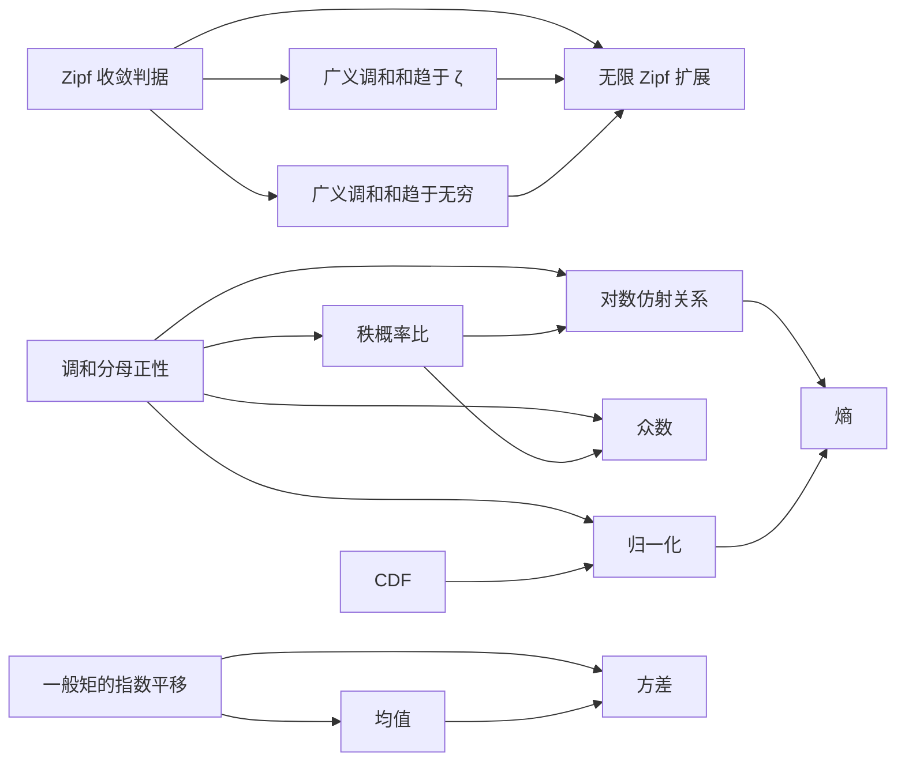

# Zipf 的定理关系

这些连接来自 Lean 归约中的实际调用。线上接口使用“子定理 → 归约提交节点 →
父定理”的路径，下图省略归约节点，表示相同的逻辑依赖方向。
根目标仍为原任务的 `zipf_infinite_extension`。

`plan.json` 保存每个声明的精确类型、来源说明、父目标和依赖清单。
`solutions/` 中的文件保持平台要求的顶层 `theorem solution`，导入并实际调用子声明。
`explanations/` 给出相同归约的数学说明。

Zipf–Mandelbrot 归一化、Yule–Simon 尾部、monkey typing 幂律与 Benford 首位数字
极限是原任务中的独立里程碑，各自保留独立根与共享定义。它们不作为无限扩展的
前置条件；没有为图的外观添加这类依赖。

## 检查与证据

1. `python missions/zipf/scripts/audit.py` 检查原始直接证明的精确平台类型。
2. `python missions/zipf/scripts/graph.py audit` 生成闭合证书并检查全部新归约。
   证书使用完整接受证明实现子声明，不导入原始 `Theorems/` 占位符。
3. `python scripts/workspace.py build zipf` 构建所有原始证明及独立图证书。
4. `graph.py publish`、`publish-poll`、`submit`、`poll` 执行可重入的发布与提交。
   子项未为 `Proved` 时，依赖它的归约暂不提交；源码变更后须重新审计。
5. `graph.py snapshot` 从平台读取每个相关 graph 与 decomposition，核对预期的
   17 条定理依赖边及其接受归约，并写入 `verification/graph-summary.json`。

最终状态以实时回读的 `verification/graph-summary.json` 和
`verification/graph-submissions.json` 为准。这个 Markdown 图表示计划结构，
本身不能替代服务端连接的验证证据。

2026-10-11 最终回读已通过：18 个相关定理均为 `Proved`，13 个新证明提交均为
`ACCEPTED`，上图 17 条逻辑依赖均在实际 graph 中找到完整路径，并能对应到
接受归约的 decomposition。原始 13 项主目标及里程碑证明也全部为 `ACCEPTED`。
